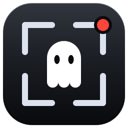

<div align="center">



# GhostRec OBS

**Record one window. Only that window.**

A Python automation layer for OBS Studio that pins a Windows window by its
handle (HWND), follows it through title changes, and stops recording the moment
you close it.

[](https://www.python.org/)
[](https://obsproject.com/)
[](https://www.microsoft.com/windows)
[](https://github.com/jaeef/ghostrec-obs/pulls)

**Pick a window → Record → Close to stop → Done.**

</div>

---

## Contents

- [Why GhostRec](#why-ghostrec)
- [Features](#features)
- [Requirements](#requirements)
- [Installation](#installation)
- [Quick start](#quick-start)
- [Usage](#usage)
- [Configuration](#configuration)
- [How it works](#how-it-works)
- [Troubleshooting](#troubleshooting)
- [Limitations](#limitations)
- [Project structure](#project-structure)
- [Contributing](#contributing)

---

## Why GhostRec

OBS Window Capture matches windows by `title:class:exe` with a priority rule.
Its "match by exe" fallback can drift to another window as soon as a title
changes — a Teams call renames itself mid-meeting and the recording jumps
windows, or stops matching entirely.

GhostRec removes that guesswork: the window is bound by **HWND**, which never
changes while the window lives. Recording continues through any title change and
ends exactly when the window closes.

You also never capture your whole screen. Other apps, notifications and your
own work stay out of the video.

---

## Features

| Area | What it does |
|------|--------------|
| **HWND lock** | Pins the exact window by handle. Title changes re-lock the same window; other windows are never captured. |
| **Dedicated scene** | Creates an OBS scene containing only the window capture source and the audio input — no manual OBS setup. |
| **Stop on close** | Closing the recorded window finalizes and saves the file. Title changes never stop it. |
| **Covered-window capture** | Uses Windows Graphics Capture (WGC) so a restored target remains isolated when another window is placed on top; warns when the target app itself throttles rendering. |
| **Audio monitoring** | Silence detection with a threshold and timeout, plus a live level meter. |
| **Recording library** | Browse, play, reveal and delete recordings, with date, size and duration details. |
| **System tray** | Idle/recording tray icon, stop-from-tray, notifications, single-instance guard. |
| **CLI + GUI** | Same core and the same `config.json`; use whichever fits. |

---

## Requirements

- **Windows** 10 or 11 (uses Win32 APIs: `win32gui`, `win32process`)
- **Python** 3.10+
- **OBS Studio** 28+ with the WebSocket server enabled (Tools → WebSocket Server Settings)
- OBS must stay open while recording — minimized is fine, closed is not

---

## Installation

### One-click (recommended)

1. Clone the repository
2. Double-click `start_gui.bat` for the desktop app, or `start_recorder.bat` for
   the CLI

The launchers check Python, install dependencies, help you enable the OBS
WebSocket server, create `config.json`, test the connection, and start the app.

### Manual

```bash
git clone https://github.com/jaeef/ghostrec-obs.git
cd ghostrec-obs

pip install -r requirements.txt
python setup.py        # interactive config helper
```

Then run either front-end:

```bash
python app.py          # desktop app (PyQt6)
python record.py       # terminal picker
```

---

## Quick start

1. Open **OBS Studio** and leave it running.
2. Launch GhostRec (`start_gui.bat` or `python app.py`).
3. Pick a window from the list, type a file name, press **Start Recording**.
4. Close the window when you are done — the recording saves automatically and
   the picker comes back for the next one.

The app connects to OBS on startup using `config.json`. Use **Connect OBS** in the
header if OBS was started afterwards.

---

## Usage

### Desktop app

| Page | What you get |
|------|--------------|
| **Record** | Window list with process/HWND details, auto-refresh, file-name field, Start button. |
| **Live** | Timer, target card (PID/HWND), status pills (output, minimized, covered), capture-source switch, audio meter, silence banner, live preview, activity log, Stop & Save. |
| **Library** | Table of recordings (name, date, size, format), details pane, Play, Show in Explorer, Delete. |
| **Settings** | OBS host/port/password with show toggle, Test Connection, 1-click Launch OBS (minimized), scene/source names, capture method and source, `capture.auto`, output folder, audio thresholds. |

Closing the window while a recording is running keeps GhostRec in the tray
instead of killing the session. Use the tray menu to stop or quit.

### CLI

```bash
python record.py                  # interactive window picker
python record.py --list           # list open windows and exit
python record.py --auto --target "Teams"   # record the first matching window
python record.py --version
```

The picker accepts a window number, `r` to refresh, `q` to quit. After a
recording finishes, the picker returns for the next one.

### Output

Files are saved to `output_folder` as:

```
<name>_YYYY-MM-DD_HH-MM-SS.<ext>
```

`<ext>` follows OBS's own recording format (`.mkv`, `.mp4`, …). Relative
`output_folder` paths resolve against the repo root in the GUI and against the
current directory in the CLI.

### Log output

```
[rec] ● STARTED  'my-class'  window='Teams Meeting'
[pin] window title changed — re-locking the SAME window: 'Teams Meeting - John'
[audio] ⚠ WARNING: no sound for 45s (last -62.3 dB). Check mic/speaker output.
[rec] ■ STOPPED  (00:45:12) — recorded window closed. Finalizing...
[file] ✔ saved -> recordings/my-class_2026-09-08_14-30-00.mkv
```

---

## Configuration

`setup.py` (or the first launcher run) creates `config.json` next to the code.
The GUI's Settings page edits the same file.

```json
{
  "obs": {
    "host": "127.0.0.1",
    "port": 4455,
    "password": "YOUR_OBS_WEBSOCKET_PASSWORD"
  },
  "capture_scene_name": "ClassRecScene",
  "capture_source_name": "ClassCapture",
  "output_folder": "./recordings",
  "poll_seconds": 3,
  "capture": {
    "method": 2,
    "source": "window",
    "covered": true,
    "auto": true
  },
  "audio": {
    "check": true,
    "input_name": "Desktop Audio",
    "silence_db": -55.0,
    "silence_alert_seconds": 30,
    "minimize_warn_seconds": 60
  }
}
```

| Key | Default | Description |
|-----|---------|-------------|
| `obs.host` | `127.0.0.1` | OBS WebSocket host |
| `obs.port` | `4455` | OBS WebSocket port |
| `obs.password` | `""` | OBS WebSocket password |
| `capture_scene_name` | `ClassRecScene` | OBS scene GhostRec creates and reuses |
| `capture_source_name` | `ClassCapture` | Window/Game capture source name |
| `output_folder` | `./recordings` | Where finished recordings go |
| `poll_seconds` | `3` | Window/status poll interval |
| `capture.method` | `2` | Window Capture method: `0` automatic, `1` BitBlt, `2` Windows Graphics Capture |
| `capture.source` | `window` | `window` = Window Capture; `game` = Game Capture for apps with OBS game hooks |
| `capture.covered` | `true` | Force Modern WGC for Window Capture so another window can cover the restored target without entering the recording |
| `capture.auto` | `true` | Detect apps that stop rendering when occluded and show the capture-source advice |
| `audio.check` | `true` | Enable silence / minimization warnings |
| `audio.input_name` | `Desktop Audio` | Audio input name in OBS |
| `audio.silence_db` | `-55.0` | Silence threshold in dB |
| `audio.silence_alert_seconds` | `30` | Silence duration before warning |
| `audio.minimize_warn_seconds` | `60` | Minimized duration before warning |

Missing keys are filled with these defaults on load; unknown keys are preserved
on save.

### Enable the OBS WebSocket server

1. **OBS Studio → Tools → WebSocket Server Settings**
2. Check **Enable WebSocket server** (port `4455`)
3. Copy the **Server Password** (or leave it empty)
4. Run `setup.py` or the launcher and paste it when asked

Prefer a manual start? Copy `config.example.json` to `config.json` and edit the
password.

---

## How it works

```
┌─────────────────────────────────────────────────────────┐
│  1. PIN by HWND        →  Exact window locked           │
│  2. RE-AIM on title    →  Same window, new title        │
│  3. STOP on close      →  Never on title change         │
│  4. DEDICATED scene    →  Only your window is captured  │
└─────────────────────────────────────────────────────────┘
```

1. **Resolve** the picked window to its `HWND`, title, class and executable.
2. **Configure** the OBS scene and source to capture that handle, plus the
   configured audio input.
3. **Start** the OBS recording and poll its status every `poll_seconds`.
4. **Watch** for title changes (re-aim the same handle), minimization, full
   occlusion and audio silence — each surfaces as a live warning.
5. **Finalize** when the window closes: stop the recording, wait for OBS to
   finish writing, then move the file into `output_folder`.

---

## Troubleshooting

| Symptom | Fix |
|---------|-----|
| Recording is black or empty (Intel iGPU) | Window Capture needs a GPU-disabled browser on these machines. Run `open_class_browser.bat` (Chrome with `--disable-gpu` and a separate profile), join in that window, then record it. Avoid the Teams desktop app. |
| Another window covers the target | Keep the target restored, enable **Covered-window protection**, and use Window Capture + Modern WGC. GhostRec captures the target surface, not the topmost browser. If the target is Chrome/Edge/Electron and its own content stops updating, use the recording-safe browser launcher; capture cannot force an app to render frames it throttles itself. |
| Recording freezes when the window is minimized | Restore the window. Minimized windows produce no frames — GhostRec warns after `audio.minimize_warn_seconds`. |
| `Connection failed` | OBS WebSocket server must be enabled, port `4455`, password identical to `config.json`. Use **Test Connection** in Settings. |
| File finalization timed out | OBS is still writing. Leave OBS open and check its own recording folder; large files take longer to close. |
| No audio in the recording | Check the OBS audio input name matches `audio.input_name`, and that Desktop Audio is not muted. |
| Wrong save location | Remember relative `output_folder` resolves against the repo root (GUI) or current directory (CLI). |

---

## Limitations

| Limitation | Details |
|------------|---------|
| Windows only | Built on Win32 (`win32gui`, `win32process`). |
| OBS must stay open | Can be minimized, never closed. |
| One recording at a time | The picker returns after the previous file is finalized. |
| Recording quality | Controlled by OBS → Settings → Output → Recording. |
| No audio isolation yet | Captures the configured OBS input (usually all desktop audio). Per-app capture is on the roadmap. |

---

## Project structure

```
ghostrec-obs/
├── app.py                     # Desktop app entry point (PyQt6)
├── record.py                  # CLI front-end (same core)
├── ghostrec/
│   ├── core/                  # No Qt imports: config, windows, obs, recorder, library, apps
│   └── ui/                    # PyQt6 shell
│       ├── pages/             #   picker, live, library, settings
│       ├── assets/            #   logo SVGs + app.ico
│       ├── branding.py        #   QIcon helpers
│       ├── theme.py           #   palette + QSS
│       ├── widgets.py         #   reusable widgets
│       ├── preview.py         #   live preview worker
│       └── tray.py            #   system tray
├── setup.py                   # Dependency & config helper
├── config.example.json        # Config template
├── requirements.txt
├── start_gui.bat              # One-click GUI launcher
├── start_recorder.bat         # One-click CLI launcher
├── open_class_browser.bat     # GPU-disabled Chrome helper (Intel iGPU)
└── README.md
```

### Where new code goes

| Adding | Location |
|--------|----------|
| OBS/Windows logic, config, recording | `ghostrec/core/` (no Qt imports) |
| A screen | `ghostrec/ui/pages/` |
| A reusable widget | `ghostrec/ui/widgets.py` |
| Colors or QSS | `ghostrec/ui/theme.py` |
| Icons or logo helpers | `ghostrec/ui/assets/` + `ghostrec/ui/branding.py` |
| A background worker | `ghostrec/ui/preview.py`, or a new `ghostrec/core/` module |
| A CLI flag | `record.py` (shares the same core) |

---

## Contributing

- Keep `ghostrec/core` free of Qt imports so the CLI and the GUI stay in sync.
- Test both front-ends against a real OBS instance before opening a PR.
- Open an issue for bugs or feature requests; PRs are welcome.

---

<div align="center">

**Record classes, meetings, or any window — keep working while it records.**

</div>
